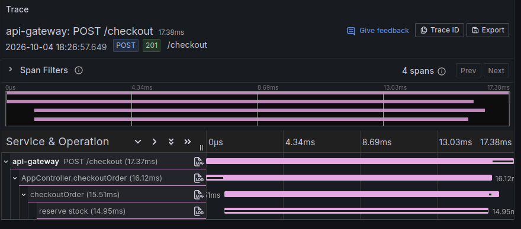
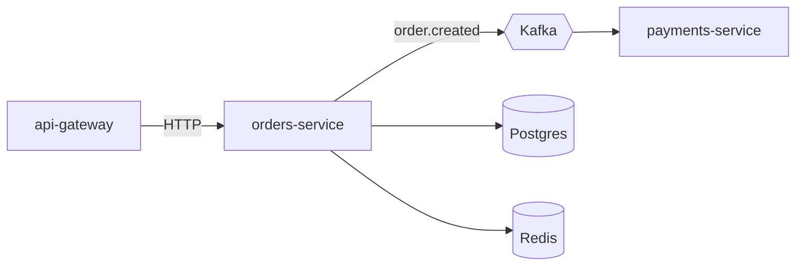

# glassbox

**Watch a NestJS system the way you would in production.**

Three small NestJS services talk over HTTP and Kafka. Every request leaves logs, a
trace and metrics. Grafana shows it all in one place.

Later the project will get **five performance bugs, added on purpose**. You find each
one with the tools.



---

## The system



1. `POST /checkout` comes into **api-gateway**. It reserves stock.
2. The gateway calls **orders-service** over HTTP.
3. orders-service reads the products (from **Redis**, or **Postgres** if Redis doesn't
   have them) and saves the order in **Postgres**.
4. orders-service sends an `order.created` message to **Kafka** and answers right away.
5. **payments-service** reads the message and charges the order (fake).

All of this is **one trace**, from the first request to the payment.

---

## Start it

You need Docker and Node 20+.

```bash
npm run setup     # install packages, create .env
npm run up        # start the tools in Docker
npm run check     # check that everything answers
npm run dev       # start the three services
```

Other commands: `npm run down` (stop), `npm run reset` (stop and delete all data),
`npm run logs`, `npm run load`, `npm run bench:loggers`.

Postman: import [`postman/glassbox.postman_collection.json`](postman/glassbox.postman_collection.json).

---

## Try it

**1. Make a checkout**

```bash
curl -X POST localhost:3001/checkout -H 'content-type: application/json' -d '{"items":[{"productId":3,"quantity":2}]}'
```

The answer has a `traceId`. Copy it.

**2. See the trace**

Grafana (http://localhost:3000) → **Explore** → top-left dropdown → **Tempo** →
**TraceQL** → paste the `traceId` → Shift+Enter.

You see all three services in one tree:

```
api-gateway       POST /checkout
  api-gateway       reserve stock          ← our own span
  api-gateway       POST                   ← gateway calls orders
    orders-service    POST /orders
      orders-service    get                  ← Redis: products in the cache?
      orders-service    pg.query:INSERT      ← Postgres: save the order
      orders-service    send order.created   ← into Kafka
        payments-service  process order.created   ← out of Kafka
          payments-service  charge card
```

**3. See the logs of that request**

Click any span → **Logs for this span**. Or in Explore → **Loki**:

```logql
{service_name=~".+"} | trace_id="paste-it-here"
```

**4. See the Kafka message**

Kafka UI (http://localhost:8080) → Topics → `order.created` → Messages. Open one
message and look at its **headers**: there is a `traceparent`.

**5. See the dashboard**

Send fake traffic with k6 (runs in Docker, takes 2 minutes):

```bash
npm run load
```

20 fake users do checkouts at the same time. The script is
[`load/checkout.js`](load/checkout.js). At the end, k6 prints a summary: how many
requests, how fast (p95), how many errors.

While it runs, open Grafana → **Dashboards** → Glassbox → **Glassbox — Services**. You
see requests per second, status codes, latency, event loop delay, Kafka messages and
memory.

---

## How it works

**Logs.** Every service writes JSON lines to `logs/*.log`. The OTel Collector reads
the files and sends them to Loki. Every line has a `trace_id`.

**Traces.** A *span* is one step of work. A *trace* is all the spans of one request.
OpenTelemetry (OTel) makes most spans by itself. We made two by hand: `reserve stock`
and `charge card`.

**Crossing services.** How does orders-service know it is part of the same trace?
OTel adds a `traceparent` header to the HTTP request. For Kafka, it puts the same
header into the message. The next service reads it and continues the trace.

```
traceparent: 00-43ffd1b608e7117deab953434832c154-a1b2c3d4e5f60718-01
                └──────── trace id ────────────┘ └─ parent span ─┘
```

**Metrics.** Numbers over time, like "requests per second". OTel makes most of them by
itself: HTTP, Kafka, event loop, memory. We made one by hand: `payments_processed_total`.
The apps send metrics to the Collector every 10 s. Prometheus reads them from there.

**Pino vs Winston.** orders-service uses Winston, the others use Pino. Same JSON
shape. Pino is about 2× faster (`npm run bench:loggers`).

---

## What is running

| | URL | What it does |
|---|---|---|
| **Grafana** | http://localhost:3000 | Look at everything here |
| **Kafka UI** | http://localhost:8080 | See Kafka messages |
| Tempo | http://localhost:3200 | Stores traces |
| Loki | http://localhost:3100 | Stores logs |
| Prometheus | http://localhost:9090 | Stores metrics |
| OTel Collector | localhost:4317 / 4318 | Gets all data first, sends it on |
| Kafka | localhost:29092 | Message queue |
| Postgres | localhost:5432 | Orders and products |
| Redis | localhost:6379 | Cache for products |
| api-gateway | http://localhost:3001 | On your machine, not in Docker |
| orders-service | http://localhost:3002 | On your machine |
| payments-service | http://localhost:3003 | On your machine |

---

## Plan

- [x] **01 Skeleton** — three services, Docker, health checks
- [x] **02 Logs** — JSON logs, Pino vs Winston, logs in Loki
- [x] **03 Traces** — OpenTelemetry, first trace, trace ↔ logs links
- [x] **04 Connect** — gateway → orders (HTTP) → payments (Kafka), one trace
- [x] **05 Metrics** — request rate, errors, latency, a Grafana dashboard
- [x] **06 Load** — k6 sends fake traffic
- [x] **07 Bugs** — Postgres and Redis, then five bugs to find (see Bug hunt)
- [ ] **08 Profiling** — see which function uses the CPU

---

## Bug hunt

The project has bugs **added on purpose**, so you can practise finding them. All are
off by default.

**How to play**

1. Run `npm run load` with no bugs. Write down p95. (Healthy: about **130 ms**.)
2. Turn a bug on in `.env`, for example `BUGS=event-loop`. Restart `npm run dev`.
3. Run `npm run load` again. Something is worse.
4. Find the cause with Grafana, **before** you open the answer.
5. Set `BUGS=` back to empty and restart.

| # | `BUGS=` | Symptom |
|---|---|---|
| 1 | `event-loop` | everything is slow, even `/health/live` |
| 2 | `n-plus-one` | order history is slow |
| 3 | `request-scope` | k6 says all is fine… but is it? |
| 4 | `broken-trace` | the checkout trace has no payment |
| 5 | `labels` | Prometheus keeps growing |

Note: the numbers below are from a laptop. Yours will be different, but the
difference between "healthy" and "bug on" should look the same.

### Bug 1 — `event-loop`

**Symptom:** checkout gets slow under load. k6 fails the p95 limit.

**Hints:**
- Dashboard → **Event loop delay**. What happens to `api-gateway`?
- Time a request that does nothing: `curl -w "%{time_total}\n" localhost:3001/health/live`
  during `npm run load`. Why is it slow?
- Open a slow checkout trace. Is there time that **no span** explains?

<details>
<summary>Answer</summary>

`receiptCode()` in `api-gateway/src/checkout.service.ts` uses `pbkdf2Sync`. A `Sync`
function runs on the main thread. For about 40 ms, Node can do **nothing else**: no
other request, not even `/health/live`.

The fix is the async version, `pbkdf2`. It runs on a worker thread, so Node keeps
serving other requests while it waits.

What we measured (20 users):

| | healthy | bug on |
|---|---|---|
| checkout p95 | 120 ms | 467 ms |
| `/health/live` p50 | 1.3 ms | 41 ms |
| `/health/live` max | 5 ms | 509 ms |
| event loop delay (max p99) | 11 ms | 407 ms |

**The lesson:** waiting (`await`) is fine. Blocking (`...Sync`, big loops, huge
`JSON.parse`) freezes **every** request, not only the slow one.

</details>

### Bug 2 — `n-plus-one`

**Symptom:** the order history (`GET /orders`) is slow. But k6's total p95 looks fine.

**Hints:**
- k6 mixes all requests together. Look at **one route**: Dashboard → **Latency p95** →
  `orders-service /orders`.
- Open a `GET /orders` trace. Count the `pg.query` spans.

<details>
<summary>Answer</summary>

`latest()` in `orders-service/src/orders.service.ts` reads the orders with 1 query,
then reads the items **once per order**, in a loop. 50 orders = **51 queries**.

The fix: one query for the items of **all** orders: `WHERE order_id = ANY($1)`. Then
it's always 2 queries, for 5 orders or 500.

| | healthy | bug on |
|---|---|---|
| queries per `GET /orders` | 2 | 51 |
| `GET /orders` p95 | 4.9 ms | 48.8 ms |
| k6 total p95 | 129 ms | 132 ms |

**The lesson:** a total number can hide one slow endpoint. And the database is fast,
so each query looks fine alone. The problem is the **count**. In a trace, N+1 looks
like a long ladder of identical small bars.

</details>

### Bug 3 — `request-scope`

**Symptom:** none in k6! Latency and errors look normal. But something grows.

**Hints:**
- Dashboard → **Memory**. Is `orders-service` bigger than the others?
- Count Redis connections before and after `npm run load`:
  `docker exec glassbox-redis redis-cli info clients | grep connected_clients`
- Open any `POST /orders` trace. What does Redis do **before** `get`?

<details>
<summary>Answer</summary>

In `orders-service/src/app.module.ts`, `ProductsService` gets `Scope.REQUEST`. Now Nest
creates a **new** `ProductsService` for every request. Its constructor opens a new
Redis connection, and nobody closes it. (Nest does not call `onModuleDestroy` for
request-scoped providers.)

And it spreads: `OrdersService` and `AppController` use `ProductsService`, so they
become request-scoped too.

| | healthy | bug on |
|---|---|---|
| Redis connections after 1 load test | 1 | 3,283 |
| orders-service heap | ~50 MB | 127 MB |
| k6 p95 | 129 ms | 132 ms |

Redis allows 10,000 connections by default. After about 3 load tests, it says **"max
number of clients reached"** and every checkout fails.

**The lesson:** use the default scope (one instance for the whole app). Only use
`Scope.REQUEST` when you really need it, and never for something that opens
connections. A leak doesn't show in latency. It shows in **counts that only go up**.

</details>

### Bug 4 — `broken-trace`

**Symptom:** the checkout trace stops at orders-service. The payment is missing.

**Hints:**
- Open a checkout trace. Is there a `send order.created` span?
- Search Tempo for Service Name `payments-service`. Where does its trace **start**?
- "Logs for this span" on a checkout: are the payment logs there?

<details>
<summary>Answer</summary>

In `orders-service/src/order-events.service.ts`, messages are not sent right away.
They wait in a list, and a timer (`setInterval`) sends them every 200 ms, in one batch.

OTel keeps "which trace am I in?" in **AsyncLocalStorage**, the same tool our `req_id`
uses. A timer that was started at app startup does not belong to any request. So
the batch is sent with **no trace**, and the payment starts a new one.

The checkout trace ends at orders. The payment is a separate trace, with
`send order.created` as its root.

The fix: send right away, inside the request. If you really need batching, save the
`traceparent` with each message when you add it to the list.

**The lesson:** context lives in the async call chain. Anything that breaks the
chain — timers, queues in memory, `EventEmitter` — breaks the trace. And there is
**no error**. You only see it if you look at the trace.

</details>

### Bug 5 — `labels`

**Symptom:** Prometheus gets bigger and bigger, even when traffic is the same.

**Hints:**
- Dashboard → **Series in Prometheus**. Compare before and after `npm run load`.
- In Explore → Prometheus: `count(payments_processed_total)`. How many? How many
  did you expect?

<details>
<summary>Answer</summary>

In `payments-service/src/payments.consumer.ts`, the counter gets `order.id` as a
label. Every new label value makes a new **series**. One series per order.

| | healthy | bug on |
|---|---|---|
| `payments_processed_total` series | 1 | 1,648 |
| all series in Prometheus | 4,590 | 6,269 |

Each series costs memory in Prometheus, forever (until it expires). With a real
shop, this is millions of series, and Prometheus runs out of memory.

The OTel SDK has a safety net: after **2,000** series per metric, it puts the rest
into one "overflow" series. That protects Prometheus, but the numbers are now wrong.

The fix: labels only for things with **few** values: status, route, service. An
order id or a user id belongs in **logs and traces**, not in metrics.

</details>

## Two traps

**OTel must start first.** `import './otel'` is the first line of every `main.ts`.
If something is imported before it, you get no traces and no error.

**Keep CommonJS.** OTel works by patching `require()`. With ESM it quietly stops
working.

---

## Layout

```
glassbox/
├── services/            NestJS monorepo
│   ├── apps/            api-gateway, orders-service, payments-service
│   └── libs/common/     health, logging, otel, kafka
├── infra/               config for every container
│   └── grafana/dashboards/   the dashboard (JSON)
├── load/                k6 load test
├── postman/             all endpoints
└── docker-compose.yml
```

## License

MIT
